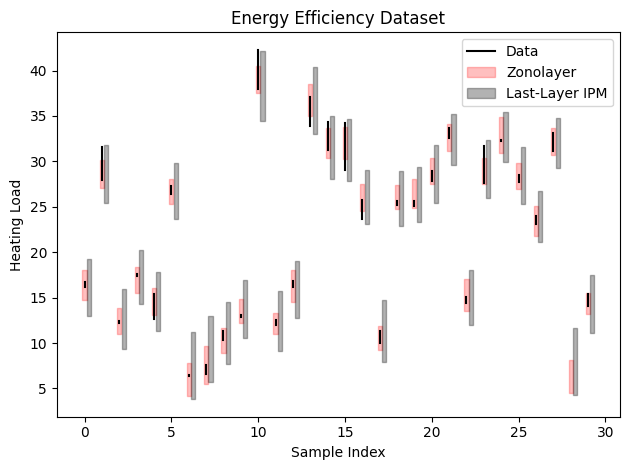
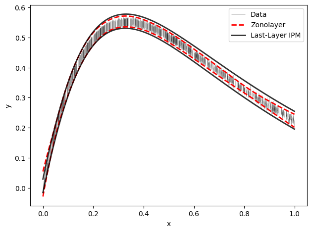

# Zonolayer

**Matthew McCann**  
_University of Strathclyde, 2026_

Developed with guidance and support from **[Marco de Angelis](https://github.com/marcodeangelis)**, University of Strathclyde

[](https://www.python.org/)
[](LICENSE)
[](https://pypi.org/project/zonolayer/)

**Zonolayer** is a Python package for **last-layer uncertainty modeling via zonotopic representations**.  
It provides **zonotopic output bounds** for neural networks with interval-bounded outputs, enabling precise and interpretable uncertainty quantification in regression tasks.

---

## Features

- Compute **zonotopic bounds** for last-layer outputs.
- Compatible with PyTorch networks. However, the general Zonotopic Regression algorithm can be modified to work with any suitable ML/DL library.
- Modular, research-friendly, and easy to use.

By default, Zonolayer relies on **NumPy** for all numerical computations and interval handling.  

If you require more advanced interval arithmetic (e.g., using [`pyinterval`](https://pypi.org/project/pyinterval/) or other specialized packages), you can install the optional dependencies and modify the code accordingly, or submit a request for support to be added. I appreciate any and all feedback.

IPM support using the [PyIPM library by J. Sadeghi](https://github.com/JCSadeghi/PyIPM)

---

## Installation

Ensure all requirements from `requirements.txt` are installed to reduce any potential issues.

```bash
pip install zonolayer
```

---
## Getting Started
See the `examples` directory for working examples with different types of neural networks and data.

### Walkthrough
This example fits a small network to interval-valued data and then uses Zonolayer to get zonotopic prediction bounds. The full script is in `examples/`.

#### 1. Interval data

Each training target is an interval `[y_lower, y_upper]` rather than a single value.

```python
import numpy as np
import torch
import torch.nn as nn
from zonolayer import Zonolayer

np.random.seed(0)

n = 500
x = np.random.rand(n)
y = 0.3 * (15 * x * np.exp(-3 * x) + np.random.normal(0, 0.025, n) * x)
y_radius = (1 / 160) * (np.abs(x - 2) + 0.5)
y_lower, y_upper = y - y_radius, y + y_radius

x_train = x.reshape(-1, 1)
x_test = np.linspace(x.min(), x.max(), 200).reshape(-1, 1)
```

#### 2. The network and the zonolayer

The network has a `feature_extractor` and a `regressor`. **The final linear layer of the feature extractor is the zonolayer.** Its width is `zono_dim`, and it sets the dimension of the latent space where the zonotope is built. It has no activation after it, so the regressor is a linear map of the zonolayer's output.

```python
class RegressionNetwork(nn.Module):
    def __init__(self, input_dim=1, hidden_dim=8, zono_dim=3):
        super().__init__()
        self.feature_extractor = nn.Sequential(
            nn.Linear(input_dim, hidden_dim),
            nn.Tanh(),
            nn.Linear(hidden_dim, zono_dim),   # <-- the zonolayer (zono_dim outputs)
        )
        self.regressor = nn.Linear(zono_dim, 1)

    def forward(self, x, return_features=False):
        features = self.feature_extractor(x)
        out = self.regressor(features)
        if return_features:
            return out, features
        return out
```

To use a different architecture, change the hidden layers freely. The only requirements are the `feature_extractor` and `regressor` attributes, and that the feature extractor ends in a linear layer of size `zono_dim`.

#### 3. Train on the interval midpoints

```python
x_t = torch.tensor(x_train, dtype=torch.float32)
y_mid = torch.tensor(0.5 * (y_lower + y_upper), dtype=torch.float32).reshape(-1, 1)

net = RegressionNetwork(input_dim=1, hidden_dim=8, zono_dim=3)
optimizer = torch.optim.Adam(net.parameters(), lr=0.01)
criterion = nn.MSELoss()

for epoch in range(3000):
    loss = criterion(net(x_t), y_mid)
    optimizer.zero_grad()
    loss.backward()
    optimizer.step()
```

#### 4. Compute the bounds

Create the `Zonolayer` **after** training so it picks up the trained weights. Set `ipm=True` to also compute the Last-Layer IPM bounds for comparison.

```python
zl = Zonolayer(net, ipm=True)
results = zl.compute(x_train, y_lower, y_upper, x_test)

results["y_lower"]    # zonolayer lower bound
results["y_upper"]    # zonolayer upper bound
results["midpoint"]   # zonotope centre
results["ipm_lower"]  # IPM lower bound (ipm=True only)
results["ipm_upper"]  # IPM upper bound (ipm=True only)
```

Behind the scenes, Zonolayer reads the zonolayer's output for the training and test inputs and fits an affine map from the training latents to the interval targets. It then propagates the interval radii through that map to give a zonotope for each test point.

### Example Plots



---
## License
MIT License

Copyright (c) Matthew McCann

Permission is hereby granted, free of charge, to any person obtaining a copy
of this software and associated documentation files (the "Software"), to deal
in the Software without restriction, including without limitation the rights
to use, copy, modify, merge, publish, distribute, sublicense, and/or sell
copies of the Software, and to permit persons to whom the Software is
furnished to do so, subject to the following conditions:

The above copyright notice and this permission notice shall be included in all
copies or substantial portions of the Software.

THE SOFTWARE IS PROVIDED "AS IS", WITHOUT WARRANTY OF ANY KIND, EXPRESS OR
IMPLIED, INCLUDING BUT NOT LIMITED TO THE WARRANTIES OF MERCHANTABILITY,
FITNESS FOR A PARTICULAR PURPOSE AND NONINFRINGEMENT. IN NO EVENT SHALL THE
AUTHORS OR COPYRIGHT HOLDERS BE LIABLE FOR ANY CLAIM, DAMAGES OR OTHER
LIABILITY, WHETHER IN AN ACTION OF CONTRACT, TORT OR OTHERWISE, ARISING FROM,
OUT OF OR IN CONNECTION WITH THE SOFTWARE OR THE USE OR OTHER DEALINGS IN THE
SOFTWARE.

